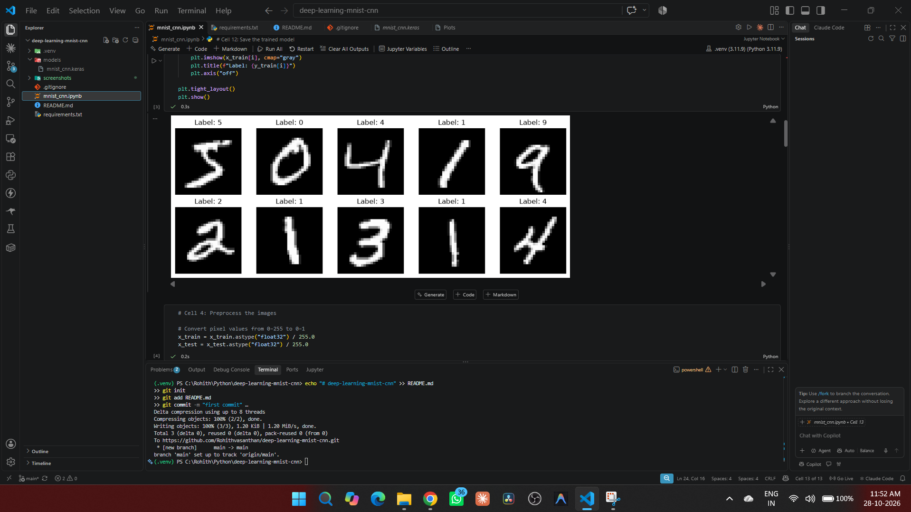
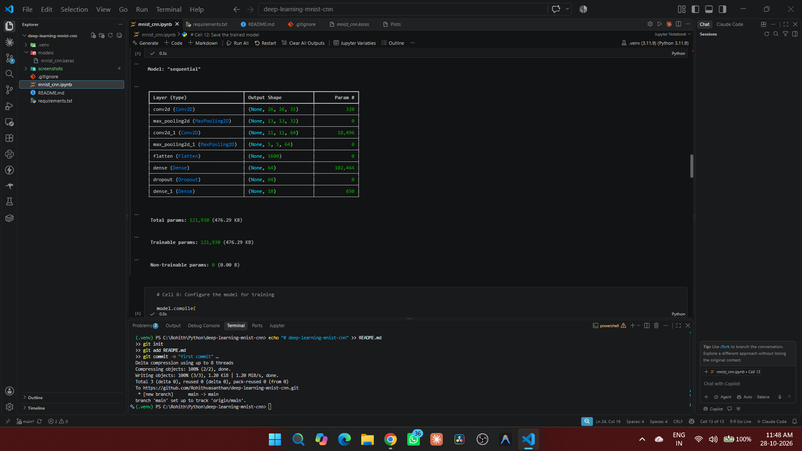
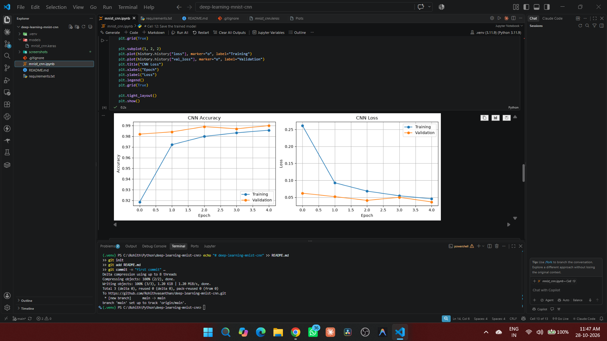
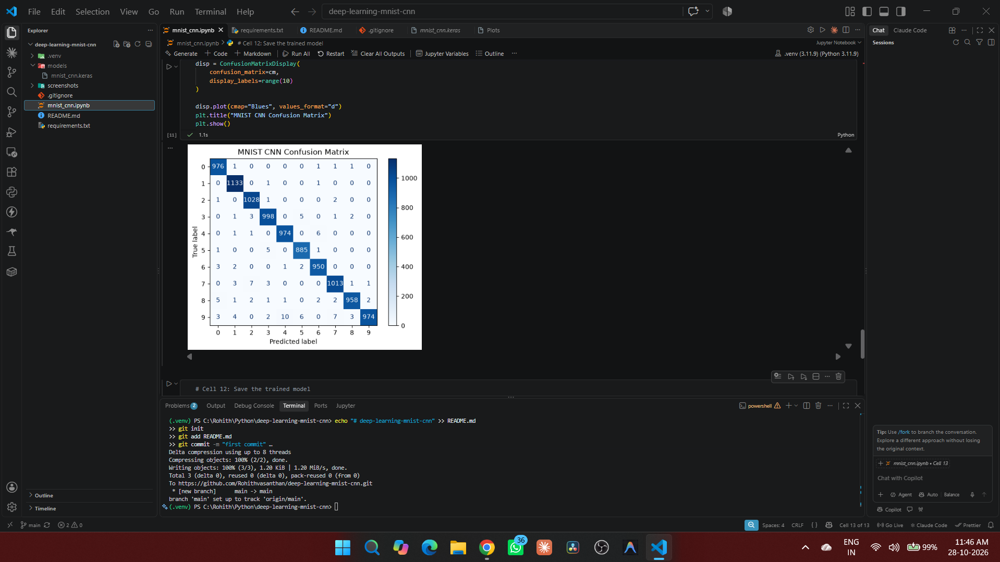

# 🧠 Handwritten Digit Recognition using CNN

A Deep Learning project that recognizes handwritten digits (0–9) using a Convolutional Neural Network (CNN) trained on the MNIST dataset.


## 📌 Project Overview

Handwritten digit recognition is an image classification task in which a machine learning model identifies numerical digits from images.

In this project, a CNN built with TensorFlow and Keras learns visual patterns from the MNIST dataset and predicts which digit appears in an input image.

This project demonstrates practical knowledge of neural networks, image preprocessing, CNN architecture, model training, evaluation, and visualization.

## 🎯 Objectives

- Understand the fundamentals of Deep Learning and CNNs.
- Load and explore an image dataset.
- Normalize image pixel values for model training.
- Build and train a CNN using TensorFlow/Keras.
- Evaluate model performance on unseen test data.
- Visualize training metrics and classification predictions.
- Save the trained model for future inference.

## 🛠️ Tech Stack

| Technology | Purpose |
|---|---|
| Python | Core programming language |
| TensorFlow / Keras | Deep Learning and CNN implementation |
| NumPy | Numerical operations and array processing |
| Matplotlib | Image and training graph visualization |
| Scikit-learn | Classification metrics and confusion matrix |
| Jupyter Notebook | Interactive development and experimentation |

## 📂 Dataset — MNIST

The MNIST dataset contains 70,000 grayscale images of handwritten digits.

- Training set: 60,000 images
- Test set: 10,000 images
- Image dimensions: 28 × 28 pixels
- Number of classes: 10 (digits 0–9)
- Input format: Grayscale images

The dataset is loaded using `tf.keras.datasets.mnist.load_data()`.

## 🖼️ Project Screenshots

### 1. Sample Handwritten Digits

The dataset contains grayscale images representing digits from 0 to 9.



### 2. CNN Model Training

The model is trained over multiple epochs, tracking training and validation accuracy and loss.



### 3. Training Performance

The accuracy and loss graphs help visualize the model's learning progress.



### 4. Classification Evaluation

The confusion matrix shows correct classifications and the digits that the model misclassifies.



## 🧠 CNN Architecture

The model uses the following layers:

1. **Input layer:** Accepts a 28 × 28 grayscale image.
2. **Convolutional layer:** 32 filters to extract visual features.
3. **Max pooling:** Reduces the spatial dimensions of feature maps.
4. **Convolutional layer:** 64 filters to learn more complex patterns.
5. **Max pooling:** Further reduces spatial dimensions.
6. **Flatten layer:** Converts feature maps into a one-dimensional vector.
7. **Dense layer:** 64 units with ReLU activation.
8. **Dropout:** Rate of 0.3 to help reduce overfitting.
9. **Output layer:** 10 units with Softmax activation, one for each digit class.

### Training Configuration

- Optimizer: Adam
- Loss function: Sparse Categorical Cross-Entropy
- Epochs: 5
- Batch size: 64
- Validation split: 10%

## 📊 Results

The notebook evaluates the trained model on the separate MNIST test dataset.

Metrics generated by the notebook include:

- Test accuracy
- Test loss
- Training and validation accuracy
- Training and validation loss
- Classification report
- Confusion matrix
- Individual digit predictions and confidence scores

**Actual test results:** Run the notebook and record the test accuracy and loss displayed by the evaluation cell. Do not use training accuracy as a substitute for test accuracy.

## ⚙️ Installation and Setup

### Prerequisites

- Python 3.11
- Visual Studio Code
- Python and Jupyter extensions for VS Code
- Internet access for the initial MNIST dataset download

### 1. Clone the repository

```bash
git clone https://github.com/YOUR-USERNAME/deep-learning-mnist-cnn.git
cd deep-learning-mnist-cnn
```

Replace `YOUR-USERNAME` with your GitHub username.

### 2. Create a virtual environment

```bash
python -m venv .venv
```

### 3. Activate the environment

Windows PowerShell:

```powershell
.\.venv\Scripts\Activate.ps1
```

### 4. Install dependencies

```bash
python -m pip install -r requirements.txt
```

### 5. Launch the notebook

Open the project folder in VS Code, open `mnist_cnn.ipynb`, select the `.venv` Python kernel, and run the cells in order.

## 💾 Saved Model

After successful training, the model is saved as:

`models/mnist_cnn.keras`

The saved model can be loaded later using:

```python
import tensorflow as tf

model = tf.keras.models.load_model(
    "models/mnist_cnn.keras"
)
```

## 🚀 Future Improvements

- Build a simple web interface for digit prediction.
- Allow users to upload their own handwritten digit images.
- Compare CNN architectures and hyperparameters.
- Experiment with data augmentation.
- Deploy the model as an interactive application.

## 📚 Key Learnings

Through this project, I practiced:

- Image data preprocessing and normalization
- CNN architecture design
- Model compilation and training
- Validation and test-set evaluation
- Model performance visualization
- Saving and loading a trained Deep Learning model

## 👨‍💻 Author

**Rohithvasanthan E**

Computer Science and Engineering Student

GitHub: [Add your GitHub profile link](https://github.com/Rohithvasanthan)

LinkedIn: [Add your LinkedIn profile link](https://www.linkedin.com/in/rohithvasanthan18)

---

*Built as part of my hands-on journey into Deep Learning and AI Engineering.*
